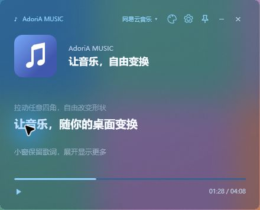
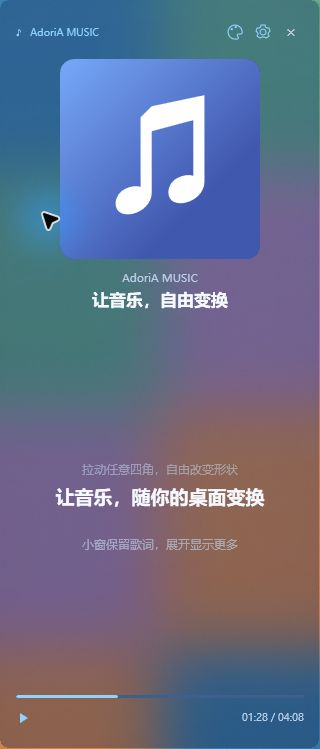

# AdoriA MUSIC

支持网易云音乐与 QQ 音乐的 Windows 悬浮窗，显示封面、同步歌词、进度与总时长，提供四种配色、毛玻璃和独立背景透明度。

## v1.5.4

从 [v1.5.4 发布页](https://github.com/114514homo666/AdoriA-Music/releases/tag/v1.5.4) 下载 AdoriA-Music-v1.5.4-win-x64.zip，完整解压，退出旧版悬浮窗后运行 AdoriA-Music.exe。无需安装或管理员权限。

Esc 不再退出悬浮窗，仅关闭已打开的菜单；使用 × 或设置中的“退出”结束应用。本版合并切歌自动恢复与游戏光标保护修复。

本版修复 QQ 切歌时歌名与时长更新不同步后停在“未匹配”的流程；资料补全后自动重新匹配，匹配缓存校验时长。QQ 与网易云首次返回空歌词或未匹配时，最多自动复核三次；过期请求不能覆盖当前歌曲。保留歌手与版本校验，避免为显示歌词接受错误歌曲。

光标保护同时检查系统光标与前台应用的鼠标捕获状态：游戏仍持有鼠标捕获时保持穿透，避免瞬间的光标可见状态误解除保护。应用释放捕获并显示系统光标后恢复操作。补上窗口已初始化后再挂接，以及 Loaded 时的兜底；不改变系统光标显示计数，不注入游戏。本轮《三角洲行动》无边框训练场测试中，用户确认菜单中可操作、关闭菜单后不再出现光标；最终包另通过新增捕获及启动检查，详见验证记录。

保留 v1.5.1 的四角残边修复与竖向空间重排。毛玻璃使用独立背景层，由 Windows 11 合成器绘制圆角，前景同为 8 DIP。Windows 10 使用普通透明背景。下方界面图沿用 v1.5.1，本版没有修改布局。

## 窗口与外观

- 拖动任意四角或四边调整大小，宽高独立变化，可做横向歌词条、竖向长窗或小窗。最小尺寸 240×64，位置和尺寸自动保存。
- 竖向空间充足时，恢复封面、歌手、上下歌词、翻译、进度和时长。封面随可用空间变大，封面、歌手和歌名纵向居中排列，歌词另占中部。
- 小窗逐步收起次要内容；最小窗保留当前歌词、播放／暂停、调色板、设置和关闭。长歌词按空间换行或省略。
- 调色板提供白、蓝、灰、黑、毛玻璃开关及 0%–100% 背景不透明度。文字和图标不随背景变淡，默认背景 35%。
- 齿轮设置集中提供播放器切换、恢复大小、置顶、精简显示、歌词偏移、重试、诊断、LRC 导入、重连和退出。菜单随主题配色。
- 没有缩放滑条、Ctrl＋滚轮缩放、右键菜单、悬停提示或文字描边。过渡动画目标为 120 帧，本机采样的动画值变化中位间隔约 8.33 毫秒。

## 播放器与歌词

顶部播放器名称或设置中选择网易云音乐／QQ 音乐；小窗使用设置。来源切换不改变歌曲播放。

QQ 音乐需启用“设置 → 常规设置 → 通知 → 显示系统媒体传输控件（SMTC）”。歌词按歌名、歌手、版本和有效时长匹配，网络失败自动重试。设置中可重试、复制诊断或导入 LRC。详见 [使用说明](使用说明.md)。

## 构建与验证

在 Windows PowerShell 中运行 ./build.ps1，使用系统自带的 C# 编译器与 WPF，无 NuGet 依赖。./verify.ps1 执行 38 项歌词及 129 项界面／恢复检查，共 167 项。本机验证范围见 [验证记录](验证记录.md)。

Windows 10/11 64 位、.NET Framework 4.x；QQ 系统媒体接口需要 Windows 10 1809 或更新版本。圆角毛玻璃需要 Windows 11 支持的系统合成接口，否则退回普通透明背景。实际效果与帧率取决于图形环境和显示器。

缓存和日志位于 %LOCALAPPDATA%\AdoriA-Music\，设置位于程序旁，不随压缩包分发。其他 PC 和其他游戏仍需复测；只绘制游戏自身光标、系统光标仍隐藏的场景，需切回桌面后操作悬浮窗。

DeepSeek 通过 ACP 协助复核本版光标保护方案；Codex 修复切歌与缓存流程，实现光标保护并完成回归验证。此前的圆角、拉伸、动画、滑条和系统媒体适配亦包含 DeepSeek 的贡献。

参考：[Microsoft 系统圆角说明](https://learn.microsoft.com/en-us/windows/apps/desktop/modernize/ui/apply-rounded-corners)、[Microsoft 动画目标帧率](https://learn.microsoft.com/en-us/dotnet/api/system.windows.media.animation.timeline.desiredframerate?view=windowsdesktop-10.0)。本项目与播放器厂商无关联。
