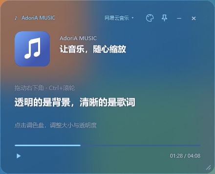
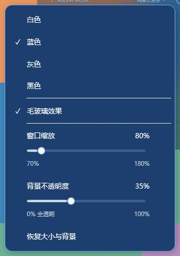

# AdoriA MUSIC

支持网易云音乐与 QQ 音乐的 Windows 悬浮窗：封面、同步歌词、播放进度、自由缩放、独立背景透明度，以及白、蓝、灰、黑四种配色和毛玻璃效果。

## 下载

从 [最新版 Releases](https://github.com/114514homo666/AdoriA-Music/releases/latest) 下载 `AdoriA-Music-v1.4.0-win-x64.zip`，完整解压后运行 `AdoriA-Music.exe`。升级前请退出旧版。

无需安装或管理员权限。支持 Windows 10/11 64 位，使用系统自带的 .NET Framework 4.x；QQ 系统媒体接口需要 Windows 10 1809 或更新版本。

## 外观

顶部调色盘或右键“颜色与毛玻璃”可切换四种颜色、开关毛玻璃，调整大小与背景不透明度。文字、进度、按钮、菜单及提示都随主题变化；配色与大小切换带过渡动画，偏好会保存。

- 缩放范围 70%–180%：拖动右下角、按住 Ctrl 滚动滚轮，或使用“窗口缩放”滑条。文字、封面、歌词和控件一起按比例变化，完整与精简模式都适用。
- 背景不透明度滑条为 0%–100%：0% 全透明，100% 实色，默认 35%。只改变背景，文字与图标保持清晰。
- 毛玻璃实时模糊窗口后的内容，去掉旧版浓重底色；滑条可连续调整通透程度。调到 0% 时关闭模糊，完整透出背景。

毛玻璃通过本窗口的 Windows 合成模糊兼容接口实现；本机 Windows 11 已实测。Windows 10 1809+ 会尝试启用，接口不支持时保留普通透明背景。系统版本和图形环境可能影响效果，软件不更改系统设置。

## 播放器与歌词

- 点击播放器名称切换网易云音乐／QQ 音乐；切换读取来源不会改变音乐播放。
- 显示封面、歌手、主歌名、同步歌词、翻译、播放进度及总时长。
- 图钉控制置顶；− / + 切换完整／精简模式；拖动空白处移动窗口。
- QQ 音乐需要启用“设置 → 常规设置 → 通知 → 显示系统媒体传输控件（SMTC）”。
- QQ 歌词联网匹配歌名、歌手及有效时长，保留版本区分；网络失败自动重试，右键可以重新获取或复制诊断信息，也可导入 LRC。

完整操作、数据来源与限制见 [使用说明](使用说明.md)。

## 从源码构建与验证

在 Windows PowerShell 中运行 `./build.ps1`，会生成 `AdoriA-Music.exe`。不依赖 NuGet 或额外安装工具，使用 Windows 自带的 C# 编译器和 WPF。

运行 `./verify.ps1` 执行 30 项歌词检查与 51 项屏幕外界面检查。验证记录见 [验证记录](验证记录.md)。保留 QQ 音乐支持及歌词兼容修复。

缓存及诊断位于 `%LOCALAPPDATA%\AdoriA-Music\`，窗口设置位于程序旁。软件不读取登录凭据、不注入代码、不修改播放器文件。

参考：[Microsoft 窗口合成接口](https://learn.microsoft.com/en-us/windows/win32/dwm/setwindowcompositionattribute)、[QQ 音乐公开接口研究](https://github.com/WXRIW/Lyricify-Lyrics-Helper/blob/master/Lyricify.Lyrics.Helper/Providers/Web/QQMusic/Api.cs)、[网易云本地播放数据研究](https://github.com/YUCLing/netease-watcher)。DeepSeek 参与动画、系统媒体适配、歌词复核及本版滑条控件制作；Codex 完成修订、集成、缩放与背景分层、毛玻璃和验证。本项目与两个播放器厂商无关联。
